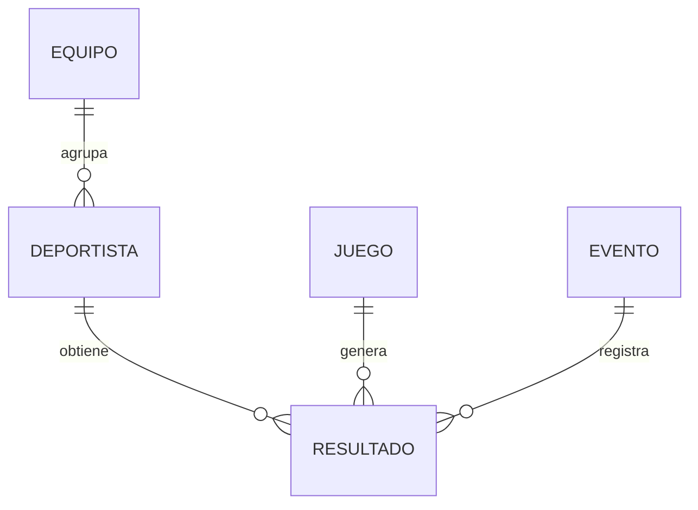
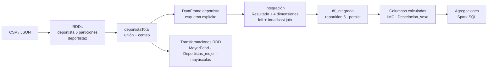

# Procesamiento de datos olímpicos con Apache Spark

Taller I del curso **Gestión de datos y tecnologías Big Data** (MCDI502). Es un flujo reproducible en PySpark que integra el registro histórico de los Juegos Olímpicos y lo analiza con RDDs, DataFrames y Spark SQL.


## Integrantes

- Yerko Gallardo
- Sebastián Rojas
- José Ignacio Rodríguez

## Objetivo

Construir, a partir de seis archivos fuente heterogéneos (CSV y JSON), un flujo de análisis distribuido, verificable y reproducible que:

1. Cree y transforme estructuras distribuidas con **RDDs** y las convierta en **DataFrames** con esquemas explícitos.
2. Integre las cinco entidades del modelo (deportista, equipo, evento, juego y resultado) en una tabla de participaciones, sin perder ni duplicar registros.
3. Aplique técnicas de **optimización y particionamiento**: proyección de columnas, *broadcast join*, persistencia y reparticionamiento.
4. Calcule variables derivadas y responda preguntas analíticas con **Spark SQL**.

Cada etapa deja controles explícitos (conciliación de conteos, unicidad de claves y cobertura de nulos), de modo que los resultados pueden auditarse desde las salidas del notebook.

## Datos

Modelo relacional con la tabla **Resultado** como hecho central: cada fila es una participación de un deportista en un evento de una edición de los Juegos.



| Archivo | Entidad | Registros | Formato |
|---|---|---:|---|
| `deportista.csv` + `deportista2.csv` | Deportista | 67.786 + 67.785 | CSV sin encabezado |
| `resultados.csv` | Resultado | 271.116 | CSV separado por `;` |
| `evento.csv` | Evento | 765 | CSV |
| `equipo.csv` | Equipo | 1.184 | CSV |
| `juegos.json` | Juego | 51 | Arreglo JSON |

**Calidad de datos detectada y tratada:**

| Problema | Tratamiento |
|---|---|
| Ceros en edad, altura y peso (dato no registrado) | Se convierten a nulo en el DataFrame; los RDDs los conservan para trazabilidad |
| Una línea con un campo vacío sobrante | Se repara sin descartar el registro |
| 280 eventos con el registro CSV doblemente encapsulado | Se normalizan con `csv.reader` antes de cargarlos |
| Etiquetas desplazadas en `juegos.json` (temporada con años, ciudad con «Verano»/«Invierno») | Se verifica la relación en todas las filas, se renombran las columnas y se conservan los campos originales |
| `#N/A` en claves y `NA` en medalla | `#N/A` se lee como nulo; `NA` se mantiene como «sin medalla» |
| 200 participaciones sin equipo identificado (`equipo_id = 0`) | Se conservan con *left join* y se reportan explícitamente |

## Metodología



| Etapa | Técnica | Control de calidad |
|---|---|---|
| Entorno | Detección o instalación de Java 17+ y PySpark, variables de entorno, SparkSession clásica | Versiones efectivas impresas |
| RDDs | `textFile` con 6 particiones, `union`, `filter`, `map` | Conciliación 67.786 + 67.785 = 135.571; ids únicos |
| DataFrames | Esquemas explícitos y lectura `FAILFAST` | Unicidad de claves y *anti joins* para referencias huérfanas |
| Integración | Proyección de columnas, *broadcast* de dimensiones pequeñas y *left joins* | Filas integradas = filas de Resultado; `resultado_id` único |
| Paralelismo | `repartition(5)` y `persist(MEMORY_AND_DISK)` | Particiones antes y después (5) y filas por partición |
| Columnas calculadas | IMC = peso / (altura / 100)², solo con medidas válidas | Caso conocido (180 cm, 80 kg → 24,69) y casos inválidos que dan nulo |
| Agregaciones | `spark.sql` con `CASE WHEN`, `GROUP BY`, `COUNT`, `SUM`, `AVG`, `MAX`, `MIN` | Totales conciliados con la entrada; mínimo ≤ promedio ≤ máximo |

## Principales resultados

La unidad de análisis es la **participación** (271.116), no la persona (135.571): quien compite varias veces pesa varias veces en las estadísticas.

**Integración.** Las 271.116 participaciones se conservan con `resultado_id` único, distribuidas en cinco particiones de alrededor de 54.200 filas cada una.

**IMC.** Se calcula en 206.853 participaciones (76,3 %); el resto no tiene altura o peso. La mediana es 22,53 y la mitad central de los valores está entre 20,96 y 24,21.

**Medallas por equipo.** De 1.012 equipos con participaciones, 507 no registran medallas. Los totales concilian con la fuente:

| Equipo | Oro | Plata | Bronce | Total |
|---|---:|---:|---:|---:|
| United States | 2.515 | 1.546 | 1.249 | 5.310 |
| Soviet Union | 1.110 | 766 | 728 | 2.604 |
| Germany | 636 | 603 | 651 | 1.890 |
| **Todos los equipos** | **13.372** | **13.116** | **13.295** | **39.783** |

**Edad por tipo de medalla.** El promedio es casi idéntico en todos los grupos, alrededor de 23,7 años:

| Medalla | Edades válidas | Promedio | Mínimo | Máximo |
|---|---:|---:|---:|---:|
| Oro | 13.224 | 23,70 | 11 | 64 |
| Plata | 12.821 | 23,75 | 11 | 73 |
| Bronce | 13.006 | 23,69 | 10 | 72 |
| Sin medalla | 222.591 | 23,70 | 11 | 97 |

**Altura por temporada.** La diferencia entre temporadas es menor a 1 cm:

| Temporada | Participaciones | Alturas válidas | Promedio (cm) | Mínimo | Máximo |
|---|---:|---:|---:|---:|---:|
| Verano | 222.552 | 170.695 | 175,52 | 127 | 226 |
| Invierno | 48.564 | 40.250 | 174,59 | 137 | 211 |

**Edad por sexo.** Las participaciones de mujeres corresponden, en promedio, a deportistas 2,57 años menores:

| Sexo | Participaciones | Edades válidas | Promedio | Mínimo | Máximo |
|---|---:|---:|---:|---:|---:|
| Hombre | 196.594 | 187.544 | 24,43 | 10 | 97 |
| Mujer | 74.522 | 74.098 | 21,86 | 11 | 74 |

**Consideraciones para interpretar.** Los conteos de medallas son registros por participación: en las pruebas colectivas cada integrante suma una medalla, por lo que no equivalen al medallero oficial. La edad proviene de la tabla de deportistas y se repite en todas las participaciones de una persona. Los nulos nunca se imputan: cada estadística informa cuántas observaciones válidas utiliza.

## Estructura del repositorio

```text
sumativa2/
├── notebooks/
│   └── mcdi502_s2_grupo1.ipynb  # Notebook ejecutable con salidas guardadas
├── data/                     # Archivos fuente del curso
│   ├── deportista.csv
│   ├── deportista2.csv
│   ├── resultados.csv
│   ├── evento.csv
│   ├── equipo.csv
│   └── juegos.json
└── docs/
    └── guion_video.md        # Guion de la presentación en video
```

El entorno (`pyproject.toml`, `uv.lock` y `.python-version`, con Python 3.14) está en la raíz del repositorio y lo comparten todas las sumativas.

Las secciones de [`notebooks/mcdi502_s2_grupo1.ipynb`](notebooks/mcdi502_s2_grupo1.ipynb) siguen los puntos de la consigna: 1. Configuración · 2. RDDs: creación y unión · 3. RDDs: transformaciones · 4. DataFrames · 5. Paralelismo · 6. Inspección · 7. Columnas calculadas · 8. Agregaciones · 9. Video · 10. Conclusiones, fuentes y cierre.

## Reproducibilidad

**Requisitos:** [uv](https://docs.astral.sh/uv/) y Java 17 o superior. Si Java no está instalado, el notebook lo instala.

```bash
git clone https://github.com/joserodriguezc/gestiondatosytecnologiasbigdata.git
cd gestiondatosytecnologiasbigdata
uv sync --locked
uv run jupyter lab
```

Abrir [`sumativa2/notebooks/mcdi502_s2_grupo1.ipynb`](notebooks/mcdi502_s2_grupo1.ipynb), seleccionar el kernel del entorno `.venv` y ejecutar todas las celdas desde un kernel reiniciado. El notebook busca la carpeta `data/` desde el directorio actual hacia arriba, por lo que funciona si Jupyter se inicia en `sumativa2/` o dentro de `sumativa2/notebooks/`.

La celda 1.1 prepara el entorno sin intervención manual:

- Reutiliza un JDK 17 o superior si ya existe: `JAVA_HOME`, `java` del PATH o las rutas habituales de Windows, macOS y Linux.
- Si no hay ninguno, lo instala: OpenJDK 17 con `apt-get` en Colab o Linux con root, o Temurin 17 con `install-jdk` en `~/.jdk` (sin permisos de administrador).
- Define `JAVA_HOME`, `PYSPARK_PYTHON`, `PYSPARK_DRIVER_PYTHON` y `SPARK_LOCAL_IP`.

Para usar un JDK concreto, definir `JAVA_HOME` antes de iniciar Jupyter.

> **Windows:** se recomienda ejecutar el notebook en Linux, macOS o WSL. En Windows nativo, PySpark 4.3 falla de forma intermitente en `take` sobre RDDs grandes (*Python worker exited unexpectedly*). Además, Spark no arranca si la ruta de la carpeta contiene tildes (*ClassNotFoundException: SparkSubmit*). Las salidas guardadas provienen de una ejecución en Linux con Java 17 (Temurin).

## Referencias

- Apache Spark. [PySpark API Reference](https://spark.apache.org/docs/latest/api/python/index.html) y [Spark SQL Reference](https://spark.apache.org/docs/latest/sql-ref.html).
- Organización Mundial de la Salud. [*Obesity and overweight*](https://www.who.int/news-room/fact-sheets/detail/obesity-and-overweight) (definición de IMC).
